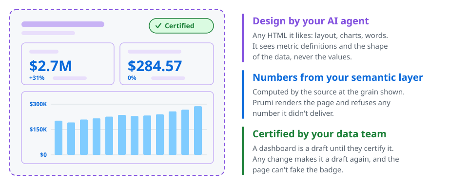
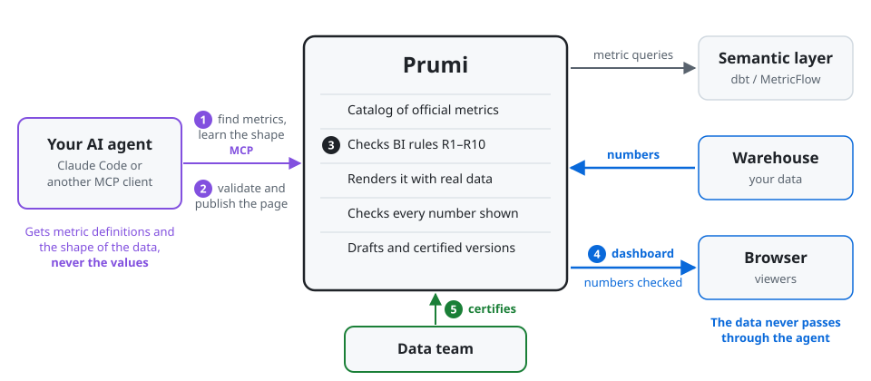

# Prumi

[](https://github.com/prumihq/prumi/actions/workflows/ci.yml)
[](https://pypi.org/project/prumi/)
[](LICENSE)

**AI dashboards with official numbers.** People build dashboards with their own AI agent and design them however they like. Prumi supplies every number from your semantic layer, checks the page before it's published, and lets the data team certify it.

<picture>
  <source media="(prefers-color-scheme: dark)" srcset="docs/images/prumi-at-a-glance-dark.svg">
  
</picture>

**Want to see it first?** [Try Prumi on a demo shop](examples/demo-dbt-project/README.md) in about five minutes, with the usual BI traps planted in its data. No project of your own needed.

> [!NOTE]
> Prumi 0.1 is a first release. It runs on one machine, for one person, with dbt on DuckDB. There's no login yet, so it can't be shared with a team. See [Status and roadmap](#status-and-roadmap).

## Why Prumi

People already build dashboards with AI: paste a spreadsheet into a chat, and a good-looking page appears in minutes. The data team can't stop it, and can't trust it. Prumi keeps the speed and fixes the numbers.

| | AI dashboards today | With Prumi |
|---|---|---|
| **The page** | Whatever the agent designs | Still whatever the agent designs: any HTML |
| **The numbers** | Worked out by the AI: averages of averages, a half month compared with a full one, totals that don't match their rows | Computed by your semantic layer at the grain shown. Prumi checks the [BI rules](docs/bi-rules.md) and refuses any number it didn't deliver ([R8](docs/bi-rules.md#r8-every-number-shown-is-a-value-prumi-delivered)) |
| **The data** | A frozen copy, pasted into the chat | Read from your warehouse, and never sent to the AI: it sees metric definitions and the shape of the data, not the values ([where your data goes](#where-your-data-goes)) |
| **The definitions** | Whatever the AI guessed revenue means | Your semantic layer's, never re-implemented. Prumi never decides who sees which rows |
| **Trust** | Nobody knows where it came from | A draft until the data team certifies a version. Any change makes it a draft again, and the page can't fake the badge |

## How it works

<picture>
  <source media="(prefers-color-scheme: dark)" srcset="docs/images/how-it-works-dark.svg">
  
</picture>

1. The agent connects to Prumi over MCP, the open protocol AI agents use for tools. It finds the official metrics in Prumi's catalog and learns the shape of the data: row counts, label lengths, magnitudes.
2. It writes a dashboard: a small spec saying which metrics, dimensions and filters to show, plus any HTML.
3. Prumi checks the spec against the BI rules, renders the page with real data, checks every number, and publishes it as a draft.
4. Viewers open it in the browser, with data that goes warehouse → Prumi → browser.
5. The data team certifies it, and the badge shows who certified it and when.

## Use it with your metrics

Prumi reads metrics from your semantic layer through an adapter, one per source.

> [!TIP]
> Not on a supported source yet, or just looking? [Try Prumi on the demo shop](examples/demo-dbt-project/README.md#try-prumi-on-it) first: it's a dbt project on DuckDB that comes with the repo.

| Source | Status |
|---|---|
| dbt Semantic Layer (MetricFlow), on DuckDB | 🟢 Supported in 0.1 |
| dbt on Snowflake, BigQuery, Databricks and Postgres | 🟡 Planned |
| Power BI semantic models | 🟡 Planned |

**Install** Prumi with the adapter for your source, and the headless Chromium it checks pages with:

```sh
uv tool install "prumi[dbt]"
prumi install-chromium   # add --with-deps on Linux if system libraries are missing
```

Prumi comes as Python packages: `prumi` is the server and the `prumi` command, and each source has its own adapter package, such as `prumi-adapter-dbt`. `prumi[dbt]` installs both; with pip, `pip install "prumi[dbt]"`.

**Configure.** Prepare your dbt project ([what Prumi reads, and how to declare display formats](packages/prumi-adapter-dbt/README.md#preparing-your-dbt-project)), then write a `prumi.toml`:

```toml
[source]
adapter = "dbt"

[source.dbt]
semantic_manifest = "my-dbt-project/target/semantic_manifest.json"

[source.dbt.connection]
type = "duckdb"
path = "warehouse.duckdb"
```

[docs/configuration.md](docs/configuration.md) lists every setting. One worth knowing: every viewer sees numbers formatted the same way, whatever their browser's language, set with `locale` under `[server]` (default `en-US`). Pages format numbers with `prumi.format` and change figures with `prumi.change`, and pass `prumi.locale` to their other `Intl` calls; validation refuses a page whose text changes with the browser's language.

**Run** Prumi, then [connect your agent](#connect-your-agent):

```sh
prumi serve --config prumi.toml
```

**Ask** your agent for a dashboard on your metrics. It replies with a link such as `http://127.0.0.1:8484/d/weekly-revenue-by-region`, and [http://127.0.0.1:8484](http://127.0.0.1:8484) lists every dashboard with its status.

**Review and certify.** A new dashboard is a draft. `prumi list` shows every dashboard and its status, `prumi certify <id> <version>` certifies a version after review, and `prumi uncertify <id>` withdraws it. `prumi requests` lists the metrics agents asked for that don't exist yet, `prumi validate` checks a spec file and its HTML, and `prumi delete` removes a dashboard. Each command takes `--config prumi.toml`.

## Connect your agent

Prumi's MCP endpoint is `http://127.0.0.1:8484/mcp` (Streamable HTTP). With Claude Code:

```sh
claude mcp add --scope user --transport http prumi http://127.0.0.1:8484/mcp
```

`--scope user` makes Prumi available in every folder. Without it, Claude Code registers the server only for the folder you ran the command in.

This release is tested with Claude Code. Any MCP client that runs on your machine and supports Streamable HTTP should connect the same way. Clients that connect from their vendor's cloud (connectors configured in a web app, for example) can't reach a server on your machine.

The server tells the agent how to work with it: build dashboards with Prumi rather than the client's own dashboard or artifact tool, use only catalog metrics and ask for missing ones with `request_metric`, never write numbers into the page, declare totals and comparisons in the spec, and validate before publishing. Validation also reports layout problems, such as overlapping or clipped text, by element path and never with the page's text. The tools:

| Tool | For |
|---|---|
| `authoring_guide` | The spec format, the page API (`prumi.*`), the result object and a working example. Agents read it once before writing. |
| `find_metrics`, `describe_metric` | Finding the official metrics and the dimensions each one can be split by. |
| `query` | Learning the shape of the data while designing: rows, empties, label lengths, magnitudes. No values. |
| `validate_spec` | Checking a spec and its HTML, or edits to earlier content (`base` + `html_edits`), optionally in more filter states (`check_states`) and at phone width. Every result has a `candidate_id`; only a clean one can be published. |
| `publish_dashboard` | Publishing a clean `candidate_id` (or a spec and HTML) as a new draft version. |
| `list_dashboards`, `get_dashboard` | Reading back published dashboards: versions, spec, HTML, status, and what viewers' browsers flagged (element paths, never the numbers). |
| `request_metric` | Asking the data team for a metric that doesn't exist yet. |

## Where your data goes

- **Dashboard data:** warehouse → Prumi → browser. It never passes through the agent or its LLM.
- **What the agent sees:** Prumi never sends company data to your agent: `query` shows the shape of the data, and the numbers appear only in the dashboard. Its LLM provider gets metric definitions, the shape of results (row counts, empties, label lengths, magnitudes), issue codes and element paths: never a value or a name from the data.
- **What Prumi stores:** specs, HTML, certifications, metric requests and the check reports from viewers' browsers, in `registry.sqlite3` under the config's `data_dir` (`.prumi` by default). Check reports keep issue codes, element paths and counts, never numbers or names from the data. No query results, and no row data or filter values in logs.

The dashboard's HTML runs in a sandboxed frame that can't call any server, and the badge and data freshness come from Prumi, not from the HTML.

## Status and roadmap

0.1 proves the whole loop on one machine: an agent finds the official metrics, builds and publishes a dashboard, a browser shows it with checked numbers, and the data team certifies it. It doesn't have login or sharing yet (it only listens on your own machine), and it connects to DuckDB only. The [changelog](CHANGELOG.md) lists what's in it and its known limits.

Planned, in this order:
- **Installable:** `docker compose`, with a trial mode on the demo that needs no clone, login and sharing with a team, dbt on Snowflake, BigQuery, Databricks and Postgres, and fiscal calendars.
- **Power BI:** an adapter for Power BI semantic models.

Releases stay 0.x until the dashboard spec, the adapter protocol and the MCP tools are stable.

## Troubleshooting

- **The agent has no Prumi tools** (it may ask you for a CSV instead): start Prumi before the agent session, because agents connect to their MCP servers when a session starts. In Claude Code, `/mcp` shows Prumi's state and reconnects it. If Prumi was added without `--scope user`, it's registered only in the folder where you ran `claude mcp add`.
- **Restart your agent sessions after upgrading Prumi.** An open session keeps the tool list and the instructions it loaded when it started.
- **`prumi serve` stops at startup:** the message names what to fix: Chromium isn't installed (`prumi install-chromium`, or `uv run prumi install-chromium` in a clone; add `--with-deps` on Linux if system libraries are missing), the semantic manifest is missing or unreadable (build the demo, or run `dbt parse` in your project), a table in the manifest doesn't exist on the connection, `host` isn't a loopback address, or `locale` isn't a tag the browser knows.

## Contributing

[CONTRIBUTING.md](CONTRIBUTING.md) explains how to set up the repository, run the tests and find your way around the code.

## Security

Please report vulnerabilities privately, as [SECURITY.md](SECURITY.md) describes.

## License

[Apache 2.0](LICENSE)
